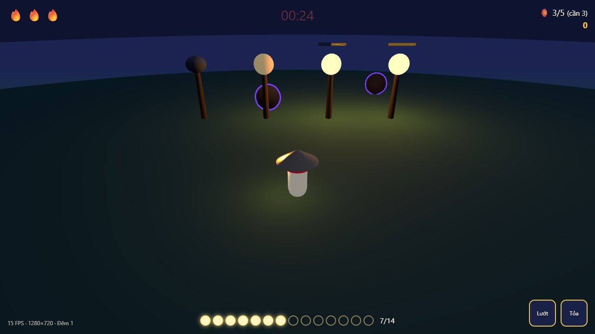
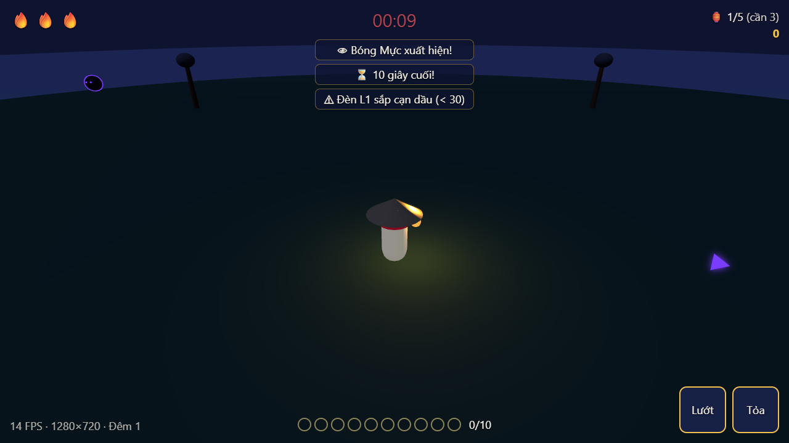

# Đảo Đèn Lồng

> **Video demo (3:13: chơi trực tiếp, tính năng, bằng chứng test/headless/bench/soak, harness AI và git):** [docs/demo/demo.mp4](docs/demo/demo.mp4) (cũng đính kèm ở [Release v1.0.0](../../releases/tag/v1.0.0)) · Bài lab Day 12 AI SDLC, cá nhân: Nguyễn Gia Bảo, 2A202603647 · Đề bài lab: [LAB-README.md](LAB-README.md) · Retro: [docs/retro.md](docs/retro.md)

Game 3D góc nhìn thứ ba. Mây, người giữ đèn nhỏ tuổi đội nón lá, đi qua ba hòn đảo (Đảo Bến, Đảo Cau, Đảo Chuông) gom đom đóm để thắp và giữ dầu cho các Đèn Lồng Lớn tới bình minh. Trên đường đi, Mây phải né và xua Bóng Mực (chúng hút dầu đèn yếu), đồng thời giữ đom đóm khỏi bị Gió Lạc cướp.




## Yêu cầu hệ thống

- Node.js ≥ 20.19 (Windows / macOS / Linux). Không cần cài gì thêm để chơi.
- Trình duyệt có WebGL2 (Chrome, Edge, Firefox, Safari bản mới).
- Riêng `bench`: Google Chrome hoặc Microsoft Edge đã cài; nếu không có thì chạy `npx playwright install chromium` một lần.

## Cài đặt và chạy (3 lệnh, sau khi clone)

```bash
npm ci            # 1. cài thư viện
npm run build     # 2. build web + headless + soak + server
npm start         # 3. mở http://localhost:4173 để chơi (node dist/server.js)
```

Bản phát hành [v1.0.0](../../releases/tag/v1.0.0) có sẵn file zip đã build: giải nén rồi chạy `node dist/server.js`.
`npm start` phục vụ game và lưu **bảng xếp hạng** vào `data/leaderboard.json`. Chế độ dev có hot reload: `npm run dev` (bảng xếp hạng khi đó lưu trong trình duyệt).

## Điều khiển (đổi được trong Cài đặt → Đổi phím)

| Phím mặc định | Hành động |
|---|---|
| W A S D | Di chuyển (theo hướng camera) |
| ← → hoặc kéo chuột | Xoay camera |
| Space | Nhảy |
| Shift trái | Lướt (14 m/s trong 0,2 giây, hồi chiêu 1,5 giây) |
| E | Nạp đom đóm vào đèn gần nhất (thắp / châm dầu) |
| F hoặc click chuột trái | Tỏa Sáng xua Bóng Mực (tốn 3 đom đóm, hồi chiêu 3 giây) |
| P (Esc luôn dùng được) | Tạm dừng: Tiếp tục / Chơi lại Đêm / Cài đặt / Về menu |

**Cài đặt** (được lưu): âm lượng, độ nhạy chuột, bảng màu dễ phân biệt, giảm chuyển động (tắt rung camera và chớp đỏ khi bị chạm), chữ lớn ×1.25, đổi phím cho mọi hành động (báo trùng phím, nút "Khôi phục mặc định"). Phụ đề báo: Bóng Mực xuất hiện (kèm mũi tên tím ở mép màn hình), gió sắp thổi, 10 giây cuối, đèn sắp cạn dầu.

## Luật chơi và cách tính điểm

- **Ba Đêm** chơi nối tiếp: Đảo Bến (5 đèn, 4 phút), Đảo Cau (hai đảo nối bằng cầu tre và bục nhảy, 6 đèn, 4 phút 30), Đảo Chuông (3 tầng, dốc, bục nhảy, gió mạnh, 7 đèn, 5 phút).
- **Đom đóm:** nhặt tự động. Sức chứa = 10 + 2 × số lần thắp thành công trong Đêm (tối đa 20). Thắp lần đầu cần 10 con, thắp lại cần 5.
- **Dầu đèn:** đèn vừa thắp có 100 dầu, hao 1/giây. Nhấn **E** ở đèn đang sáng để châm: mỗi đom đóm +10 dầu. Dưới 30 dầu thì đèn nhấp nháy và mất vùng an toàn; hết dầu thì tắt.
- **Bóng Mực** tìm tới đèn yếu để hút dầu (5/giây), đuổi Mây khi ở trong 12 m. Bị chạm: mất 1 Ngọn Lửa (có 3), rơi một nửa số đom đóm, bất tử 1,5 giây. Không vào được vùng an toàn 6 m quanh đèn sáng đủ dầu.
- **Tỏa Sáng** làm Bóng Mực trong 5 m choáng 2 giây và bị đẩy lùi 4 m.
- **Rơi khỏi đảo:** mất 1 Ngọn Lửa và toàn bộ đom đóm. **Gió Lạc** (Đêm 2, 3) cướp tới 3 đom đóm. **Bùa Gió** cho chạy nhanh 10 giây.
- **Thắng:** còn sống tới bình minh và số đèn đang sáng ≥ 60% (3/5, 4/6, 5/7). **Thua:** hết Ngọn Lửa, hoặc thiếu đèn lúc bình minh.
- **Bảng xếp hạng:** sau màn Bình Minh hoặc khi thua, nhập tên (3–12 ký tự: chữ, có thể có dấu tiếng Việt, số, `_`). Giữ top 10; xem từ menu chính.

| Sự kiện | Điểm |
|---|---|
| Mỗi đom đóm nạp vào đèn (thắp, thắp lại, châm dầu) | +5 |
| Thắp lần đầu / thắp lại | +100 / +40 |
| Bóng Mực trúng Tỏa Sáng | +5 (tổng +15 nếu nó đang hút dầu) |
| Khi thắng: mỗi đèn đang sáng | +50 + floor(dầu) |
| Khi thắng: mỗi Ngọn Lửa còn lại | +50 |

Tổng điểm là tổng điểm các Đêm đã thắng. Luật chi tiết và giả định: [SPEC.md](SPEC.md).

## Kiểm thử

```bash
npm test                 # vitest: luật, contract, tất định, bench scene, soak, bảng xếp hạng
npm run verify -- 4      # build + chạy mọi scenario (Phase 1–3) qua CLI thật, 2 lần, ghi docs/proof/phase-4/
npm run shots -- 4       # ảnh bằng chứng giao diện (Playwright) -> docs/proof/phase-4/screens/
node scripts/demo.mjs <dir-chứa-output-lệnh> demo.webm   # quay video demo (Playwright, cửa sổ Chrome thật)
```

## Chế độ headless (Test Contract v1.3)

Khai báo: [game.contract.json](game.contract.json). Sau khi build:

```bash
node dist/headless.js --seed 1 --night 1|2|3 --ticks 600 --out out.jsonl \
  [--scenario s.json] [--inputs i.json] [--snapshot-every 10]
node dist/server.js --export-leaderboard out.json      # {"entries":[...]} đúng thứ tự
```

Một Đêm đầy đủ 21.600 tick chạy khoảng 0,25 giây. Đầu ra headless của Phase 1–3 giữ nguyên từng byte ở v1.3.

## Benchmark

```bash
node scripts/bench.mjs --seed 42 --duration 30 --out bench.json    # cần build trước
```

- Mở **cửa sổ trình duyệt thật** 1280×720 (không toàn màn hình) bằng Playwright, tải cảnh bench chuẩn: Đêm 1, 200 Bóng Mực `wander`, 100 đom đóm, L1–L3 sáng 100 dầu, camera bay vòng r = 30 m, Y = 15 m, 15 s/vòng. Khởi động 3 s, đo đúng `--duration` giây rồi thoát mã 0.
- **Vsync:** đây là bản web, không tắt vsync trong engine được. Trình duyệt chạy với `--disable-gpu-vsync --disable-frame-rate-limit`. `vsync_off` chỉ ghi `true` khi FPS đo được vượt 65 (tức không bị khóa ở 60 Hz).
- **`peak_mem_mb` = null:** Chromium chạy game trong tiến trình renderer/GPU riêng mà Playwright không cho đọc RSS. `js_heap_peak_mb` ghi bộ nhớ JS heap của trang để tham khảo.
- Kết quả tự đo ([bench.json](bench.json), laptop i5-12500H, iGPU Intel UHD, Windows 11): avg 157,3 FPS, 1% low 49,7 FPS, p95 12,2 ms, load 2127 ms (ngưỡng: ≥ 60 / ≥ 30 / ≤ 10000).

## Soak test

```bash
node --expose-gc --no-opt dist/soak.js --seed 7 --nights 10 --out soak.json
```

10 Đêm liên tiếp trong một tiến trình (Đêm 1 → 2 → 3 xoay vòng, Đêm thứ i tính từ 0 dùng seed 7 + i), input ngẫu nhiên theo seed. Kết quả tự đo ([soak.json](soak.json)): 0 crash, RSS 32,9 → 36,5 MB (1,11×).
`--no-opt` tắt trình biên dịch tối ưu TurboFan của V8: khi bật, RSS tăng một lần khoảng 13 MB trong Đêm đầu (bộ nhớ của trình biên dịch) rồi đi ngang, còn JS heap thì gần như không đổi. Bằng chứng: [docs/notes/phase-4.md](docs/notes/phase-4.md).

## Sáng tạo của tôi

- Bóng Mực chạm Mây thì camera rung nhẹ và màn hình chớp đỏ (tắt được bằng "Giảm chuyển động").
- Âm thanh và nhạc tổng hợp bằng WebAudio, không dùng file asset.
- Hệ thống phụ đề có hàng đợi (tối đa 3 dòng, không chồng lặp).

Phần sáng tạo chỉ nằm ở lớp render; headless và cảnh bench không bị ảnh hưởng.

## Tài liệu dự án

- [SPEC.md](SPEC.md): luật, giả định, tiêu chí nghiệm thu · [CHANGELOG.md](CHANGELOG.md) · [CREDITS.md](CREDITS.md) · [LICENSE](LICENSE)
- [docs/tickets/](docs/tickets/) (nguyên văn) · [docs/adr/](docs/adr/) · [docs/notes/](docs/notes/) (nhật ký AI, đánh giá từng phase, [prompt gửi Codex](docs/notes/ai-prompts.md)) · [docs/proof/](docs/proof/) (bằng chứng) · [docs/retro.md](docs/retro.md)
- Harness AI: [CLAUDE.md](CLAUDE.md), [.claude/settings.json](.claude/settings.json) (Stop hook chặn kết thúc khi test đỏ), [.claude/skills/verify-phase](.claude/skills/verify-phase/SKILL.md), [CI](.github/workflows/ci.yml)
